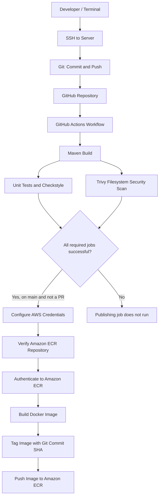

# VProfile CI/CD Pipeline with GitHub Actions, Docker & Amazon ECR

A DevOps project that automates application build validation, testing, security scanning, and Docker image publishing using **GitHub Actions**, **Maven**, **Trivy**, **Docker**, and **Amazon Elastic Container Registry (ECR)**.

> **Pipeline outcome:** On eligible pushes to `main`, GitHub Actions builds the Java application, runs unit tests and Checkstyle, scans the repository for vulnerabilities, then builds and pushes a tagged Docker image to Amazon ECR.

---

## Table of Contents

- [Project Overview](#project-overview)
- [Architecture](#architecture)
- [Repository Structure](#repository-structure)
- [Tools and Technologies](#tools-and-technologies)
- [Workflow Triggers](#workflow-triggers)
- [Pipeline Stages](#pipeline-stages)
- [AWS and GitHub Configuration](#aws-and-github-configuration)
- [Run the Pipeline](#run-the-pipeline)
- [Artifacts and Image Tagging](#artifacts-and-image-tagging)
- [Security Notes](#security-notes)
- [Troubleshooting](#troubleshooting)

## Project Overview

The project uses a Git-based workflow and a GitHub Actions pipeline to standardize application validation and container image delivery.

The setup process was:

1. Connected to the remote machine/server through SSH using a terminal.
2. Used Git to push the project source code to GitHub.
3. Opened and managed the project in Visual Studio Code.
4. Created the GitHub Actions workflow YAML file under `.github/workflows/`.
5. Created a Dockerfile for packaging the application.
6. Configured AWS IAM credentials with permissions scoped to the required AWS resources.
7. Added the AWS credentials as GitHub repository/environment secrets and configured the AWS region as a GitHub variable.
8. Created an Amazon ECR repository named `vprofile-appimage`.
9. Implemented a CI/CD workflow to build, test, scan, and publish the Docker image.

## Architecture


### Github Actions

### Pipeline summary

- **Source control:** GitHub repository
- **CI:** Maven build, unit tests, Checkstyle, and Trivy filesystem scan
- **Containerization:** Dockerfile at `Docker-files/app/Dockerfile`
- **Container registry:** Amazon ECR repository `vprofile-appimage`
- **Automation:** GitHub Actions
- **Image versioning:** Full Git commit SHA (`${{ github.sha }}`)

## Repository Structure

The following structure is based on the project layout shown in Visual Studio Code. Some application folders may contain additional files.

```text
actionsprofile/
├── .github/
│   └── workflows/
│       └── main.yml                 # GitHub Actions CI/CD workflow
├── ansible/                          # Ansible-related configuration
├── Docker-files/
│   ├── app/
│   │   └── Dockerfile                # Application image definition
│   ├── multistage/                   # Multi-stage Docker examples/config
│   ├── db/                           # Database-related Docker files/config
│   └── web/                          # Web-tier Docker files/config
├── src/                              # Application source code
├── pom.xml                           # Maven project/build configuration
├── docker-compose.yml                # Local multi-container setup
├── d.txt                             # Project file (as shown in workspace)
└── README.md                         # Project documentation
```

> Adjust the tree if the actual repository contains additional files or if any folder names differ. The workflow specifically references `Docker-files/app/Dockerfile`.

## Tools and Technologies

| Technology | Purpose |
|---|---|
| Git and GitHub | Source control and collaboration |
| SSH | Terminal access to the remote server |
| Visual Studio Code | Editing YAML, Docker, and project files |
| GitHub Actions | CI/CD workflow orchestration |
| Java 21 (Temurin) | Java runtime/toolchain for the build |
| Apache Maven 3.9.9 | Build and test automation |
| Trivy | Filesystem vulnerability scanning |
| Docker | Building the application container image |
| AWS IAM | Identity and permission management |
| Amazon ECR | Private Docker image registry |

## Workflow Triggers

The workflow is named **Build Workflow** and runs on:

- **Push to `main`**
- **Pull requests targeting `main`**
- **Manual execution** through `workflow_dispatch`
- **Scheduled execution** Monday–Friday at `02:10 UTC` (`07:40 AM IST`)

The schedule uses GitHub Actions cron syntax:

```yaml
schedule:
  - cron: '10 2 * * 1-5'
```

The publishing job has an additional condition: it only runs when the ref is `main` and the event is not a pull request. Therefore, pull requests can run validation jobs without publishing an image to ECR.

## Pipeline Stages

### 1. Build — `Maven Build`

- Checks out the repository with full history (`fetch-depth: 0`).
- Sets up Java 21 using Temurin.
- Configures Maven 3.9.9.
- Runs `mvn clean install -DskipTests`.
- Uploads the generated WAR file from `target/*.war` as the `vprofile-app` artifact.
- Prints a failure notification message if the build job fails.

**Note:** `-DskipTests` skips test execution during this build command; tests are run in the separate Testing job.

### 2. Test — `Unit Test and Checkstyle`

This job depends on the build job (`needs: build`) and runs:

```bash
mvn test
mvn checkstyle:checkstyle
```

It checks the unit tests and runs the configured Checkstyle report goal.

### 3. Security — `Trivy Security Scan`

This job also depends on the build job and scans the repository filesystem for operating-system and library vulnerabilities:

- Scanner: `aquasecurity/trivy-action@v0.36.0`
- Scan type: filesystem (`fs`)
- Vulnerability types: `os,library`
- Output: `trivy-results.json`
- Uploaded artifact: `trivy-scan-results`

The configured `exit-code: '0'` means that findings alone do **not** fail this job. The scan results should still be reviewed. Configure an appropriate severity threshold and non-zero exit code if vulnerabilities should block publishing.

### 4. Build and Publish — `BUILD_AND_PUBLISH`

This job depends on the build, test, and security jobs. It runs only for the `main` branch when the event is not a pull request.

It performs the following operations:

1. Reads AWS credentials from GitHub secrets and the region from a GitHub variable.
2. Verifies that the `vprofile-appimage` ECR repository exists.
3. Authenticates Docker to Amazon ECR.
4. Builds an image using `Docker-files/app/Dockerfile`.
5. Tags the image with the Git commit SHA.
6. Pushes the image to Amazon ECR.

The image reference follows this format:

```text
<AWS_ACCOUNT_ID>.dkr.ecr.<AWS_REGION>.amazonaws.com/vprofile-appimage:<GIT_COMMIT_SHA>
```

The account ID, region, registry hostname, and resulting tag are supplied at runtime by AWS/GitHub Actions.

## AWS and GitHub Configuration

### AWS IAM

An IAM user was configured for programmatic access to the required AWS resources. Its permissions should follow **least privilege**, limited to the ECR actions and repository resources required by the workflow.

The workflow uses these values:

- `AWS_ACCESS_KEY_ID` — stored as a GitHub secret
- `AWS_SECRET_ACCESS_KEY` — stored as a GitHub secret
- `AWS_REGION` — stored as a GitHub Actions variable

### GitHub configuration

In the GitHub repository, open **Settings → Secrets and variables → Actions** and configure:

| Name | GitHub setting | Purpose |
|---|---|---|
| `AWS_ACCESS_KEY_ID` | Secret | IAM access key ID |
| `AWS_SECRET_ACCESS_KEY` | Secret | IAM secret access key |
| `AWS_REGION` | Variable | AWS region containing the ECR repository |

The workflow also declares the `production` GitHub Environment for the publishing job. If environment-scoped secrets or variables are used, configure them under **Settings → Environments → production**.

> Never place AWS credentials directly in source code, the Dockerfile, YAML files, terminal logs, or this README. Do not commit secrets to Git. For production workloads, consider GitHub Actions OIDC federation with an AWS IAM role to avoid long-lived access keys.

### ECR prerequisites

Before running the publishing job:

- The AWS account and region must be correct.
- The ECR repository `vprofile-appimage` must already exist.
- The configured IAM identity must be allowed to describe the repository and authenticate/push images.
- The GitHub `production` environment and its variables/secrets must be configured as intended.

## Run the Pipeline

1. Commit and push your changes to `main`, or open a pull request targeting `main`.
2. In GitHub, open **Actions → Build Workflow**.
3. Select a workflow run to view the build, test, security, and publishing jobs.
4. Review the uploaded `vprofile-app` WAR artifact and `trivy-scan-results` report where applicable.
5. For a successful eligible push to `main`, open Amazon ECR and verify the new image tagged with the commit SHA.

You can also start a run manually using **Actions → Build Workflow → Run workflow**, because `workflow_dispatch` is enabled.

## Artifacts and Image Tagging

| Artifact / output | Description |
|---|---|
| `vprofile-app` | WAR file(s) matched by `target/*.war` |
| `trivy-scan-results` | JSON report generated by Trivy |
| Docker image | Built from `Docker-files/app/Dockerfile` and pushed to ECR |
| Image tag | `${{ github.sha }}` — identifies the source commit |

Using the commit SHA as the tag makes each published image traceable to the source revision that produced it.

## Security Notes

- Keep IAM permissions restricted to the required ECR repository and actions.
- Prefer OIDC role assumption over long-lived AWS access keys where practical.
- Review Trivy findings; the current `exit-code: '0'` setting does not block the pipeline on findings.
- Protect the `main` branch and require review/checks as appropriate.
- Consider pinning third-party GitHub Actions to full commit SHAs for stronger supply-chain security.
- Do not publish images from untrusted pull requests. The current publishing condition excludes pull-request events.
- The workflow currently uses `permissions: contents: read`; add only the minimum additional permissions needed if the workflow changes.

## Troubleshooting

| Problem | Things to check |
|---|---|
| Maven build fails | Java version, Maven configuration, dependencies, and build logs |
| No WAR artifact found | Confirm the build creates a file under `target/*.war` |
| Tests or Checkstyle fail | Review test output, Checkstyle configuration, and project code |
| Trivy artifact missing | Check the scan step logs and whether `trivy-results.json` was generated |
| AWS authentication fails | Verify secret names, IAM key status, and environment-level configuration |
| ECR repository not found | Verify `AWS_REGION`, AWS account, and repository name |
| Docker push is denied | Review IAM ECR permissions and the registry/repository URI |
| Publishing job is skipped | Confirm the run is on `main`, is not a pull request, and all required jobs succeeded |

---

## Author Notes

This README documents the pipeline configuration provided for this project. Update it if the workflow, AWS setup, or repository structure changes.

**Key result:** Automated application build, test and code-style validation, filesystem vulnerability scanning, and Docker image publishing to Amazon ECR through GitHub Actions.
